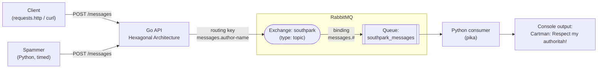
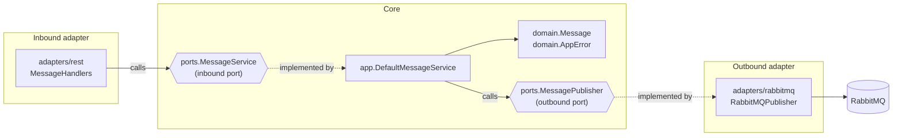
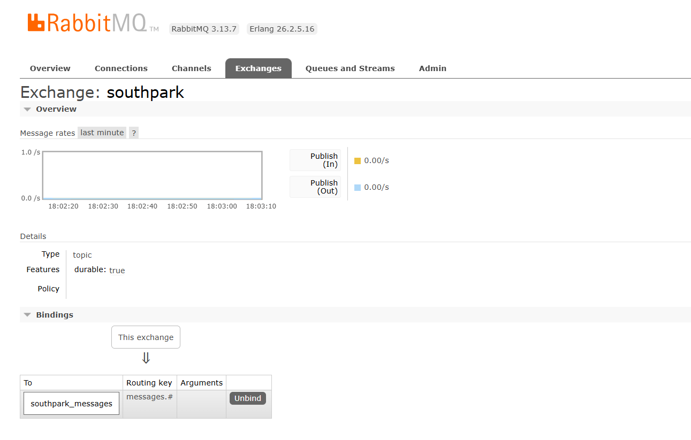
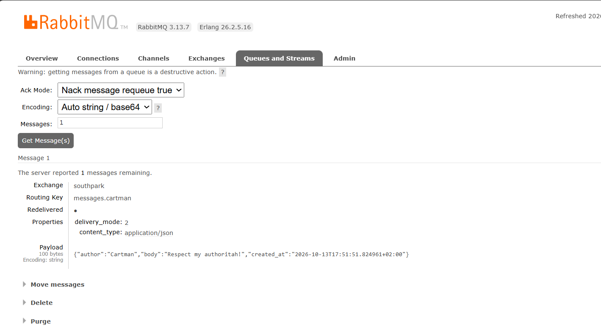

# South Park Messenger

A small distributed microservice application that lets South Park characters send and receive messages **asynchronously**.

A **Go HTTP API** built with **Hexagonal Architecture (Ports & Adapters)** accepts messages and publishes them to a **RabbitMQ topic exchange**. A **Python consumer** listens on the `southpark_messages` queue and prints every message to the console. A **timed spammer script** keeps the town busy with random South Park quotes.

Everything starts with a single command: `docker compose up --build`.

---

## Table of contents

1. [Architecture](#architecture)
2. [Quick start](#quick-start)
3. [Using the API](#using-the-api)
4. [The Go API: Hexagonal Architecture](#the-go-api-hexagonal-architecture)
5. [RabbitMQ: topic exchange](#rabbitmq-topic-exchange)
6. [Python consumer](#python-consumer)
7. [Timed spammer](#timed-spammer)
8. [Docker Compose](#docker-compose)
10. [Tests](#tests)
11. [Design decisions](#design-decisions)
12. [Project structure](#project-structure)

---

## Architecture



| Service    | Technology                   | Port(s)                            | Role                                          |
|------------|------------------------------|------------------------------------|-----------------------------------------------|
| `go-api`   | Go, gorilla/mux, amqp091-go  | `8080`                             | Accepts `POST /messages`, validates, publishes |
| `rabbitmq` | `rabbitmq:3-management`      | `5672` (AMQP), `15672` (dashboard) | Message broker, the "mailbox" of South Park   |
| `consumer` | Python 3.13, pika            | –                                  | Reads the queue and prints messages           |
| `spammer`  | Python 3.13 (standard library only) | –                           | Sends a random South Park message every 5 s   |

---

## Quick start

**Requirements:** [Docker Desktop](https://www.docker.com/products/docker-desktop/) (running).
No local Go or Python installation is needed.

```bash
git clone https://github.com/nazpedawi/southpark-messenger.git
cd southpark-messenger
docker compose up --build
```

After startup you will see the full chain in the logs:

```
spammer-1   | [201] sent Cartman: "Screw you guys, I'm going home!"
go-api-1    | RabbitMQ: published to "southpark" with routing key "messages.cartman"
consumer-1  | Cartman: "Screw you guys, I'm going home!"   (routing key: messages.cartman)
```

| What                         | Where                                                          |
|------------------------------|----------------------------------------------------------------|
| Go API                       | http://localhost:8080/messages                                 |
| RabbitMQ management dashboard | http://localhost:15672 (login: `southpark` / `southpark`)     |

Stop everything with `Ctrl + C`, then:

```bash
docker compose down
```

---

## Using the API

### `POST /messages`

**Request**

```json
{
  "author": "Cartman",
  "body": "Respect my authoritah!"
}
```

**Responses**

| Status | When | Example body |
|---|---|---|
| `201 Created` | Valid message, published to RabbitMQ | `{"author":"Cartman","body":"Respect my authoritah!","created_at":"2026-10-13T17:51:51+02:00"}` |
| `400 Bad Request` | Missing or empty `author` | `{"code":400,"message":"author is required"}` |
| `400 Bad Request` | Missing or empty `body` | `{"code":400,"message":"body is required"}` |
| `400 Bad Request` | Malformed JSON / empty request body | `{"code":400,"message":"invalid JSON: unexpected EOF"}` |
| `400 Bad Request` | Wrong type (e.g. `"author": 123`) | `{"code":400,"message":"invalid JSON: json: cannot unmarshal number ..."}` |
| `405 Method Not Allowed` | Any method other than `POST` | – |
| `500 Internal Server Error` | RabbitMQ could not accept the message | `{"code":500,"message":"could not publish message"}` |

Whitespace-only values (`"   "`) count as empty. Invalid messages are **never** published to RabbitMQ.

### Try it

**VS Code:** open [`requests.http`](requests.http) with the [REST Client](https://marketplace.visualstudio.com/items?itemName=humao.rest-client) extension and click **Send Request** above each example (valid and invalid cases are included).

**curl** (Git Bash / macOS / Linux):

```bash
curl -i -X POST http://localhost:8080/messages \
  -H "Content-Type: application/json" \
  -d '{"author":"Kenny","body":"Mmmph mmph mmmph!"}'
```

---

## The Go API: Hexagonal Architecture

The Go API follows **Hexagonal Architecture (Ports & Adapters)**: the business core sits in the middle and talks to the outside world **only through interfaces (ports)**. Concrete technology (HTTP, RabbitMQ) lives in **adapters** at the edges.



### Layers

| Layer | Folder | Contents | Depends on |
|---|---|---|---|
| **Domain** | `go-api/domain/` | `Message` entity + `NewMessage` constructor (business rules: author and body are required), `AppError` | nothing |
| **Ports** | `go-api/ports/` | `MessageService` (**inbound** port) and `MessagePublisher` (**outbound** port), both Go interfaces | `domain` |
| **App** | `go-api/app/` | `DefaultMessageService` implements `MessageService`; holds a `MessagePublisher` interface | `domain`, `ports` |
| **Adapters** | `go-api/adapters/rest/` | **Inbound** adapter: `MessageHandlers` (REST controller) + `writeResponse` helper | `ports`, `domain` |
| | `go-api/adapters/rabbitmq/` | **Outbound** adapter: `RabbitMQPublisher` implements `MessagePublisher` | `ports`, `domain`, amqp091-go |
| **Composition root** | `go-api/main.go` | Wires everything together: publisher → service → handlers → router | everything |

**Dependency rule:** dependencies only point **inward**. The domain imports no other layer. The app layer only knows interfaces. Only the adapters (and `main.go`) know about HTTP or RabbitMQ.

### How a request flows

1. `adapters/rest` decodes the JSON body. Malformed JSON gives `400`.
2. It calls `MessageService.SendMessage(author, body)` (the inbound port).
3. `app.DefaultMessageService` calls `domain.NewMessage(...)`, which enforces the business rules. A missing field gives a `400` `AppError`.
4. The service calls `MessagePublisher.Publish(message)` (the outbound port), never RabbitMQ directly.
5. `adapters/rabbitmq` serializes the message to JSON and publishes it to the topic exchange.
6. The handler returns `201 Created` with the message.

### Swappable adapters

During development the API first ran with a **temporary logging publisher** in `main.go`, before RabbitMQ existed. Switching to RabbitMQ meant changing **one line** in `main.go`.

The unit tests use the same idea: a **fake publisher** replaces RabbitMQ entirely (see [Tests](#tests)).

## RabbitMQ: topic exchange

Messages do not go straight into a queue. They follow the full AMQP routing path: **producer → routing key → exchange → binding → queue → consumer**.

| Element | Value |
|---|---|
| Exchange | `southpark`, type **topic**, durable |
| Queue | `southpark_messages`, durable |
| Binding key | `messages.#` (everything that starts with `messages.`) |
| Routing key | `messages.<author>`, e.g. `messages.cartman`, `messages.mr__garrison` |
| Message | JSON `{"author", "body", "created_at"}`, `content_type: application/json`, persistent (`delivery_mode: 2`) |

The routing key is built from the author name: lowercased, with every character that is not `a-z` or `0-9` replaced by `_`. Dots must be removed, because RabbitMQ uses them to separate routing-key words.

**Why a topic exchange?** The producer does not need to know who listens. A new consumer can subscribe to just part of the traffic **without any change to the Go API**. For example, a queue bound with `messages.cartman` would receive only Cartman's messages, next to the existing queue that receives everything.

### Evidence

_Add your screenshots to `docs/images/` and they will show up here:_

| Exchange `southpark` (topic) with binding `messages.#` | Message in the queue with routing key `messages.cartman` |
|---|---|
|  |  |

### Asynchronous decoupling

Because the queue is durable and messages are persistent, the API keeps working while the consumer is offline:

1. Stop the consumer: `docker compose stop consumer`
2. Send a few messages. They pile up in the queue (visible as *Ready* in the dashboard).
3. Start it again: `docker compose start consumer`. All waiting messages are printed at once.

---

## Python consumer

[`consumer/consumer.py`](consumer/consumer.py) uses **pika**, the RabbitMQ Python client:

1. Connects to RabbitMQ (with **retry**: 10 attempts, 3 s apart).
2. Declares the **same** exchange, queue and binding as the Go publisher. Declaring is idempotent, so it doesn't matter which service starts first.
3. Consumes `southpark_messages` one message at a time (`prefetch_count=1`).
4. Parses the JSON and prints it, then **acknowledges** the message (manual ack). If the consumer crashes before printing, the message stays in the queue instead of being lost.

Example output:

```
 [*] Waiting for messages from South Park. To exit press CTRL+C
Cartman: "Respect my authoritah!"   (routing key: messages.cartman)
Kenny: "Mmmph mmmph mmph mmmph!"   (routing key: messages.kenny)
```

---

## Timed spammer

[`spammer/spammer.py`](spammer/spammer.py) picks a random South Park quote every `SPAM_INTERVAL_SECONDS` (default 5) and `POST`s it to the Go API. It goes through the same validation as any other client.

- Uses **only the Python standard library**, so it has no dependencies.
- If the API isn't reachable yet (e.g. during startup) it logs a message and retries on the next tick instead of crashing.
- Configurable through environment variables: `GO_API_URL`, `SPAM_INTERVAL_SECONDS`.

---

## Docker Compose

[`docker-compose.yml`](docker-compose.yml) runs four services.

**Startup order:** RabbitMQ needs several seconds to start. Three layers make sure that can't break the system:

1. **Healthcheck:** compose runs `rabbitmq-diagnostics ping` every 5 s. `go-api` and `consumer` only start once RabbitMQ is healthy (`depends_on: condition: service_healthy`).
2. **Retry logic in code:** both the Go API and the consumer retry the connection (10 × 3 s).
3. **`restart: on-failure`:** a last-resort safety net.

**Service discovery:** inside Docker, services reach each other by **service name**. The API connects to `amqp://…@rabbitmq:5672/`, and the spammer calls `http://go-api:8080`. This is why all connection URLs are environment variables, with `localhost` as the default for local development.

**Credentials:** RabbitMQ credentials are **not hardcoded in the code**. They come from environment variables, which can be set in a `.env` file (see [`.env.example`](.env.example)). `.env` is in `.gitignore`. Compose falls back to the default `southpark`/`southpark`, so `docker compose up --build` works from a clean clone. Use letters and numbers only, because the password becomes part of a URL.

---

## Tests

The app layer is unit tested with a **fake publisher** that replaces RabbitMQ. This is only possible because the service depends on the `MessagePublisher` **interface** and not on RabbitMQ itself.

```bash
cd go-api
go test ./... -v
```

| Test | Checks |
|---|---|
| `TestSendMessage_PublishesValidMessage` | A valid message is returned and published exactly once |
| `TestSendMessage_RejectsMissingAuthor` | Whitespace-only author → `400`, nothing published |
| `TestSendMessage_RejectsMissingBody` | Empty body → `400` |
| `TestSendMessage_ReturnsPublisherError` | A failing publisher → `500` is passed through |

---

## Design decisions

The structure follows the patterns from the course material (REST-Golang and EDA slides, and the `GolangREST` / `golangRabitMQ` example repositories).

| Decision | Why |
|---|---|
| `AppError` with `Code` + `Message`, `AsMessage()`, helper constructors | Same pattern as the course's `GolangREST` example; lets the domain express *what* went wrong and the adapter map it to an HTTP status |
| Inbound port `MessageService` + `DefaultMessageService` + `NewMessageService(...)` | Mirrors `CustomerService` / `DefaultCustomerService` / `NewCustomerService` from the course |
| Handler struct wrapping the service interface + `writeResponse` helper | Mirrors `Customerhandlers` / `writeResponse` from the course |
| Separate `ports/` and `adapters/` folders | The assignment asks for app / domain / ports / adapters; it keeps the outbound adapter out of the domain, as the slides on adapters describe |
| `json` tags on the domain struct | As in the course's `Customer` struct; keeps the JSON contract (`author`, `body`) explicit |
| A request struct inside the REST adapter | The shape of incoming HTTP JSON is an HTTP concern; clients cannot set `created_at` themselves |
| `github.com/rabbitmq/amqp091-go` instead of `streadway/amqp` | `streadway/amqp` (used in the course demo) is no longer maintained; `amqp091-go` is its official successor with the same API |
| `PublishWithContext` with a 5 s timeout | `Publish` is deprecated in amqp091-go; the timeout prevents a request from hanging forever |
| `sync.Mutex` around publishing | Go serves HTTP requests concurrently, but an AMQP channel must not be used by two goroutines at once |
| Topic exchange instead of the default exchange | Meets the "topic related" requirement and lets future consumers subscribe to subsets of messages |
| Durable exchange/queue + persistent messages | Messages survive a RabbitMQ restart |
| Manual ack in the consumer | A message is only removed after it has been processed |
| gorilla/mux with `.Methods("POST")` | Same router as the course; other methods automatically get `405` |

---

## Project structure

```
southpark-messenger/
├── go-api/
│   ├── main.go                         # composition root (wiring)
│   ├── domain/
│   │   ├── message.go                  # Message + NewMessage (business rules)
│   │   └── apperror.go                 # AppError + helpers
│   ├── ports/
│   │   ├── message_service.go          # inbound port
│   │   └── message_publisher.go        # outbound port
│   ├── app/
│   │   ├── message_service.go          # DefaultMessageService
│   │   └── message_service_test.go     # unit tests with a fake publisher
│   ├── adapters/
│   │   ├── rest/
│   │   │   ├── message_handlers.go     # inbound adapter (POST /messages)
│   │   │   └── write_response.go       # JSON response helper
│   │   └── rabbitmq/
│   │       └── publisher.go            # outbound adapter (topic exchange)
│   ├── go.mod / go.sum
│   ├── Dockerfile                      # multi-stage build
│   └── .dockerignore
├── consumer/
│   ├── consumer.py                     # pika consumer
│   ├── requirements.txt
│   ├── Dockerfile
│   └── .dockerignore
├── spammer/
│   ├── spammer.py                      # timed random-message script
│   └── Dockerfile
├── docs/images/                        # screenshots used in this README
├── docker-compose.yml
├── .env.example                        # documents the optional .env settings
├── requests.http                       # example requests (VS Code REST Client)
├── .gitignore
└── README.md
```

---
